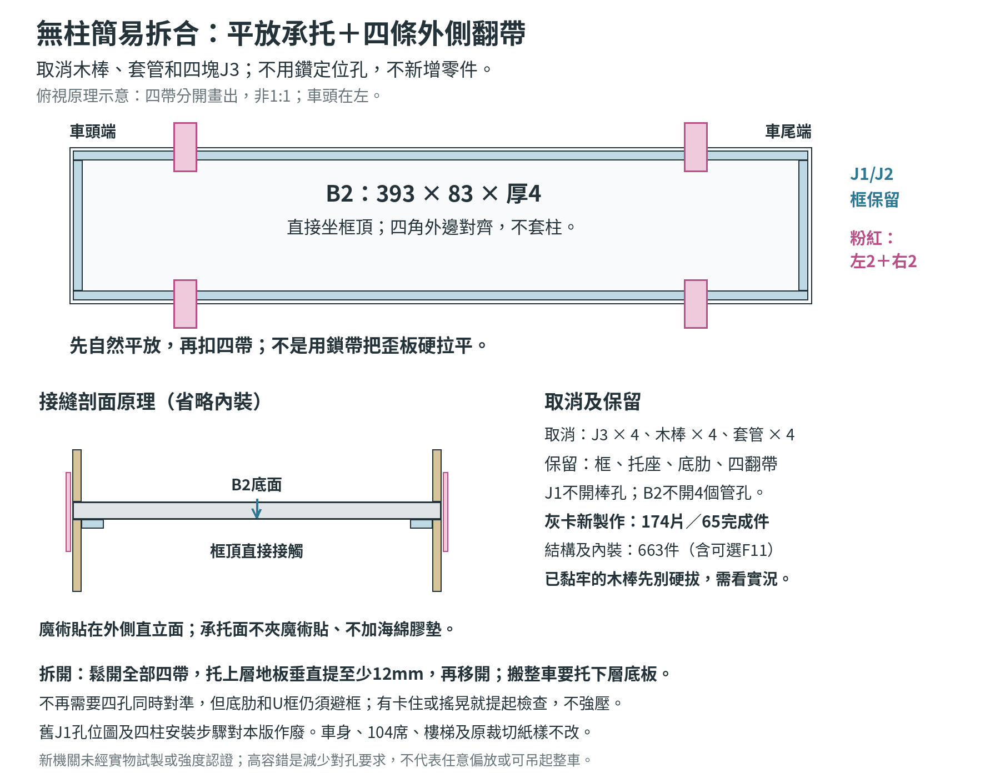

# HK-104 39.3厘米無柱拆合修訂

2026-10-23，按用戶「刪除4柱，用更簡單、快捷、容錯率高的方法」要求，取消四柱插接，改為「原承托框平放承重＋四條外側魔術貼翻帶固定」。不新增定位件、不鑽定位孔、不改104席、車身、樓梯或地板高度；只簡化上下層拆合機關。這是最新機關方案，未經實物試製或強度認證，先乾合試驗。

## 現在保留與取消甚麼

|項目|無柱版做法|
|---|---|
|J1兩條|保留，每條389 × 5 × 厚2毫米；不開木棒孔|
|J2兩條|保留，每條69 × 5 × 厚2毫米；與J1同平面，框外389 × 79、內空379 × 69|
|J7／J8|保留12個薄卡托座及24片三角撐，承托J1/J2；不能連框一起取消|
|B2上層地板|仍393 × 83 × 厚4毫米，只留原樓梯孔；不開4個套管孔|
|J4、J5、J6、J9|原尺寸及位置保留；底肋、U框仍須避開承托框，不能歪放硬壓|
|J10／J11|保留4條翻帶及4對魔術貼，左右各2條；全部在外側直立面，不墊在承托面|
|J3四塊|新製作取消：不用裁36片灰卡，也不做9層盲孔|
|J12四根木棒|取消|
|J13四段套管|取消|
|R1／R2車頂裙邊|不變，仍只負責可取車頂定位，不開孔|

原1毫米灰卡只能整層疊厚的要求不變。J1/J2仍2層，B2仍4層，不磨成小數厚度；其他薄卡不是1毫米灰卡。

## 最簡單的組裝次序

1. **做下層原承托框**：用無孔J1/J2完成框，J7/J8按原設計支承；框頂與下層牆頂齊平，保持水平。不要刪除承托框，也不要把J1/J2疊角。
2. **做無管孔B2**：保持4毫米地板、樓梯孔、U框及豎肋；不用做J3、木棒或套管。外皮、上下層牆仍分件，不能把接縫包死。
3. **先平放試合**：翻帶全部打開。雙手托上層地板，先看四角及前後外緣對齊，再垂直放在框上；確認B2底面坐在框頂，不靠樓梯、座椅或扶手承重。
4. **檢查是否真坐平**：四角輕按不應明顯搖晃；若只一角翹起、下方肋或U框撞框，提起重新對齊，先查凸膠／翹曲／干涉，不能用鎖帶硬拉平。原底肋兩側名義間隙約0.6毫米，無柱不等於能大幅偏放。
5. **在外側乾貼四條翻帶**：沿用左右兩側各x61.41、331.59毫米的位置；實物遇窗、包紙或裝飾則先乾貼找牢固牆面。翻帶上端固定上層，下端與下層外側魔術貼配對，不能把上、下層永久黏成一件。
6. **自然落座才扣帶**：先輕扣一組對角翻帶，再扣另一組；只按合魔術貼，不把上層拉歪。四帶的作用是限制鬆脫與滑移，承重仍由框和牆頂負責。
7. **拆開時**：先打開全部4帶，雙手托上層地板，垂直提起至少12毫米，讓11.053125毫米底肋離開下層框／牆頂，再移開。不要抓車頂、窗框或扶手；分層保存仍用至少12毫米高邊墊避開底肋。
8. **驗收後才包紙及正式固定帶**：反覆試放、拆開，建議先做20次基本檢查，觀察帶的黏底有沒有翹起、牆／框有沒有鬆開或地板偏位；這不是耐久或承重認證。

不再要四孔同時對準，避免木棒傾斜或管孔偏差造成卡死；但它不是自動扣正的卡榫，仍需用眼對齊外邊。若要搬動整架巴士，從下層底板托起，不能抓上層把下層吊起，也不要倒轉整架模型。

## 魔術貼不能放在哪裏

- **不要夾在J1/J2頂與B2底之間**：水平承托面直接接觸，沒有額外墊高。否則層高、樓梯頂及外皮接縫都要重算。
- **不要用厚海綿膠遮住承托面**：凸起會令上層搖晃，不是容錯補償。
- **不要靠拉緊翻帶矯正歪框**：先修正承托面和翹曲，膠完全乾透再試。

原J10每條12.28125 × 31.01875毫米，反摺7.9828125毫米；J11每面12.28125 × 9.2109375毫米，4鉤＋4毛。這些原件先乾貼試用；若現有帶已按實物裝好，無須為了這次取消柱管而全部換掉。

## 已做了部分四柱怎樣辦

- **只畫線，還未開孔**：不用再開J1的4個木棒孔或B2的4個管孔；剛才的J1孔位圖、四柱專篇及舊柱管定位步驟對這個版本已作廢。
- **已開J1或B2孔，但未黏柱管**：先保留原孔試合，不必為了孔重做整塊。小孔不會自動令四邊不能承托；仍須檢查孔邊有沒有裂、起層或明顯變軟。要遮B2孔，只在可見上表面貼薄紙，不在下方承托面加厚。
- **J3已黏在框底，木棒還未黏**：J3可原位留著不用，不要為了省件撬壞框；新製作數量與你已用的材料會不同。
- **套管已黏，但底端沒有凸出B2底**：可以原位留作不用的舊件，不需要硬拆；上層仍試放坐平。
- **木棒已黏牢、或套管／殘膠凸出承托面**：先不要硬拔、撬框或強壓上層。先確認實際完成狀態或提供照片，再決定保留、修齊或局部重做；本修訂不假設已能安全直接拔除。

## 新製作材料數量修正

|項目|原四柱版|無柱版|
|---|---:|---:|
|1毫米灰卡裁片|210|174|
|灰卡完成件|69|65|
|J3用灰卡|36片|0|
|J12定位木棒|4根|0|
|J13定位套管|4段|0|
|其他薄卡、透明片、幼管、四翻帶及四對魔術貼|原數量|不變|
|結構／內裝裁件，含可選F11、不含外皮及人仔|707|663|
|不做可選F11時|706|662|

計算：灰卡210−4×9＝174；總裁件707−36−4−4＝663。這是全新按無柱版製作的理論數量；已黏留用的J3或套管仍是實際已用材料，不能當它們不存在。備料張數仍需留排料、試件及損耗，不能把減少44件直接當相同百分比減少購紙。

## 舊全車42步教程的替換範圍

|原步驟|無柱版修正|
|---|---|
|1、2|分袋不放J3/J12/J13；試件改為一角承托＋一條外側翻帶試合|
|8、9|J7/J8及J1/J2保留；J1不鑽孔|
|10、11|取消J3和定位木棒，改查框頂水平及無凸膠|
|12|B2只開梯孔，取消4個管孔|
|13、14|U框及豎肋保留|
|15、16|取消套管安裝，改成對齊外緣、B2平放及四角搖晃檢查|
|29、30、32|座椅與上層牆不變；不再套柱，改平放乾合|
|37、40|四翻帶仍用外側直立面，平放後才輕扣|
|41|解除四帶、垂直抬起至少12毫米再移開，不沿用舊「提7毫米脫柱」|
|42|點數時取消柱、管及J3；儲存邊墊至少12毫米不變|

其餘車身、104乘客席、人仔、門、車頂、外皮及樓梯的有效尺寸沿用現有39.3厘米修正。原裁切紙樣及PDF不動；量位時手工略過取消的件及孔。現行[全車42步](../bus-tutorial-393.html)、[無柱17步](../frame-tutorial-393.html)、[50項清單](../checklist.html)及[尺寸頁](../revision-393.html)已按無柱方案更新；本表保留作舊步驟對照，勿再使用先前下載的四柱舊圖。

## 圖檔與核算原始檔

本資料夾附示意PNG、`no-post-spec.json`及生成腳本`build_no_post_guide.py`。腳本讀取上一層保留的四柱歷史基線`HK-104-39.3cm-尺寸核算.json`，扣除J3/J12/J13後核對174／65／663，並檢查承托高度不變及12毫米提起量大於底肋高度；不代表實物強度驗證。重新生成需Python 3、Pillow及Noto Sans CJK字型，於資料夾內執行`python3 build_no_post_guide.py`。
